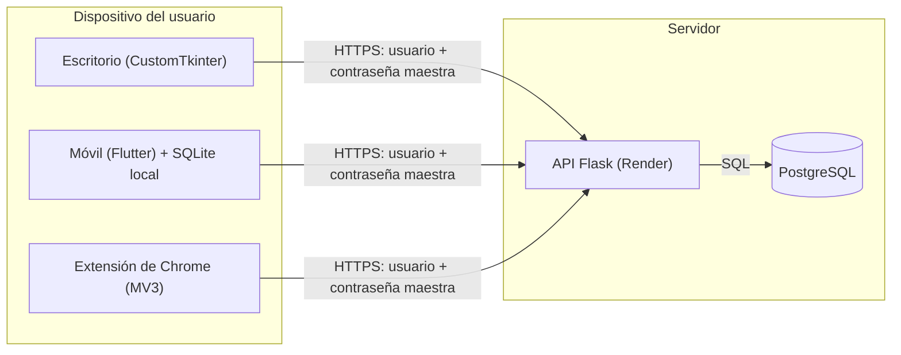

# Modelo de amenazas de Lockbox

Cumple el control **DIS-01 · P1** del checklist de seguridad: qué protegemos, contra quién, por dónde pueden atacar y qué **no** cubrimos.

- **Versión:** 1.0 · 21 de octubre de 2026
- **Estado del código analizado:** rama `main`, commit `ebc0598`
- **Alcance del análisis:** lectura del código de `app_api.py`, `app_db.py`, `seguridad.py`, `app_gui.py`, `lockbox_mobile/` y `Lockbox_Extension/`. No es una auditoría completa ni una prueba de penetración.

---

## 1. Componentes en alcance

| Componente | Tecnología | Archivos | Dónde corre |
|---|---|---|---|
| API | Flask + gunicorn | `app_api.py`, `seguridad.py`, `app_db.py` | Render (`lockbox-appi.onrender.com`) |
| Base de datos | PostgreSQL (`DATABASE_URL`) | `app_db.py` | Servicio externo (el código menciona Supabase) |
| App de escritorio | Python + CustomTkinter | `app_gui.py` | PC del usuario |
| App móvil | Flutter | `lockbox_mobile/` | Android / iOS del usuario |
| Extensión de navegador | Chrome Manifest V3 | `Lockbox_Extension/` | Navegador del usuario |
| API heredada | FastAPI | `api.py` | Ningún cliente la usa; ver T-14 |

Los tres clientes hablan con la misma API por HTTPS. No hay acceso directo a la base de datos desde los clientes.

---

## 2. Qué protegemos (activos)

| Activo | Importancia | Dónde vive hoy |
|---|---|---|
| Contraseñas guardadas por el usuario | Crítica | BD cifradas con Fernet; en claro en memoria de la API al descifrar y en memoria/caché de los clientes |
| Contraseña maestra | Crítica | Solo su hash bcrypt en la BD; en claro en tránsito (HTTPS), en memoria de la API, del escritorio y de la extensión, y en el almacén seguro del móvil |
| Clave de recuperación (`LOCK-XXXX-XXXX`) | Alta | Hash bcrypt en la BD; el usuario la guarda en papel |
| Sitios, usuarios de login, categorías y fechas | Alta | En claro en la BD (no cifrados) |
| Tokens JWT (acceso 15 min, refresco 7 días) | Media | Memoria del cliente / Keystore o Keychain en móvil / `chrome.storage.session` en la extensión |
| Secretos del servidor (`JWT_SECRET_KEY`, `DATABASE_URL`) | Crítica | Variables de entorno en Render; `.env` local fuera de git |
| Integridad y disponibilidad de la bóveda | Alta | BD y copia local del móvil |

---

## 3. Modelo de confianza (lo más importante de este documento)

**Lockbox hoy no es de conocimiento cero ni cifrado de extremo a extremo.**

- Los clientes envían la **contraseña maestra en claro** (dentro de HTTPS) en cada petición a la API.
- La API verifica el hash bcrypt, **deriva la clave Fernet en el servidor** (PBKDF2-HMAC-SHA256, 600 000 iteraciones, sal de 16 bytes por usuario) y **cifra o descifra allí**. Las contraseñas descifradas viajan de vuelta al cliente.
- Varios comentarios del código (`api.py`, `popup.js`) hablan de «Zero-Knowledge». Eso describe una intención, no el flujo real de `app_api.py`. El módulo criptográfico de `popup.js` (`deriveKeys`, `encryptLocal`) existe pero no se usa.

Consecuencias:

- **Quien obtenga solo un volcado de la base de datos** ve datos cifrados y hashes lentos, pero no las contraseñas. Debe atacar la contraseña maestra por fuerza bruta (ver T-04).
- **Quien controle el proceso de la API, sus logs o el proxy mientras alguien inicia sesión** puede capturar la contraseña maestra y todo lo que descifre (ver T-05). Hoy no hay defensa contra esto.

**En qué confiamos:** en el servidor y su proveedor (Render y el proveedor de la BD) para la confidencialidad de lo que pasa por la API, y en el sistema operativo y el hardware del dispositivo del usuario.

**Decisión pendiente** (relacionada con DIS-12, GP-01 y GP-05): o se migra a cifrado de extremo a extremo real, o se mantiene este modelo y se comunica con honestidad como «cifrado en reposo con clave derivada de tu contraseña», sin llamarlo conocimiento cero.

---

## 4. Adversarios

| ID | Quién | Qué puede hacer | ¿En alcance? |
|---|---|---|---|
| A1 | Atacante remoto anónimo | Probar contraseñas, enumerar usuarios, abusar de la API | Sí |
| A2 | Quien obtiene la base de datos (filtración, copia de seguridad, error del proveedor, inyección SQL) | Ataque offline contra hashes y datos cifrados | Sí |
| A3 | Atacante en la red (Wi-Fi hostil, proxy) | Interceptar o alterar tráfico | Sí |
| A4 | Sitio web malicioso o phishing | Engañar al autorrelleno de la extensión | Sí |
| A5 | Persona con el móvil o el PC un rato (robo, descuido) | Abrir la app, leer datos locales | Sí, con límites (sección 7) |
| A6 | Atacante a la cadena de suministro (dependencias, cuentas de GitHub, Render, Chrome Web Store) | Colar código malicioso | Sí |
| A7 | Servidor o proveedor comprometido o malicioso | Leer todo lo que pasa por la API | Aceptado hoy, no mitigado (T-05) |
| A8 | Malware con ejecución en el dispositivo del usuario | Leer memoria, teclado, pantalla | **No** (sección 7) |

---

## 5. Amenazas, defensas actuales y riesgo residual

Los IDs entre paréntesis son controles del checklist que cerrarían la brecha. Este documento **no** los marca como hechos.

| ID | Amenaza | Qué hay hoy | Riesgo residual |
|---|---|---|---|
| T-01 | **Fuerza bruta** contra el login y contra los endpoints que validan la contraseña maestra (A1) | Flask-Limiter: login 5/min, registro y recuperación 3/min, credenciales 30/min, global 60/min, por IP. bcrypt con coste 12. Mensaje genérico en login | Contadores en memoria (`memory://`): se pierden al reiniciar y no se comparten entre workers de gunicorn. Solo por IP, no por cuenta. Sin MFA (AUT-01, AUT-02, AUT-03) |
| T-02 | **Enumeración de usuarios** (A1) | El login responde igual con usuario o contraseña incorrectos | `/api/register` dice «El usuario ya existe» y `/api/recover` dice «El usuario no existe» (PWD-08) |
| T-03 | **Autenticación débil por diseño** (A1) | Hay JWT con rotación y lista de revocación | Los endpoints de credenciales usan `token_opcional_log` (modo «soft launch»): aceptan peticiones sin JWT. Solo la contraseña maestra autentica; el JWT hoy no protege nada (ACC-01, SES-08) |
| T-04 | **Robo o filtración de la BD** (A2) | Contraseñas con Fernet (AES-128-CBC + HMAC-SHA256) y clave PBKDF2 600 000 iteraciones. Contraseña maestra y clave de recuperación con bcrypt | Sitio, usuario y categoría en claro. La contraseña maestra solo exige 8 caracteres y no se compara con una lista de filtradas, lo que facilita el ataque offline (PWD-04, PWD-05, GP-08) |
| T-05 | **Servidor, logs o proxy comprometidos** (A7) | HTTPS en tránsito; secretos del servidor por variables de entorno | La contraseña maestra llega en claro al proceso en cada petición. Compromiso total para cualquier usuario que inicie sesión durante el incidente (GP-01, GP-05, GP-70) |
| T-06 | **Filtración de `JWT_SECRET_KEY` o `DATABASE_URL`** (A6) | Obligatorios al arrancar; `.env` está en `.gitignore` | `repomix-output.xml` está versionado aunque figura en `.gitignore`: comprobar que no contiene secretos. Sin rotación de secretos. HS256 simétrico (SEC-01, SEC-03, SEC-08) |
| T-07 | **Abuso de la recuperación de cuenta** (A1, A2) | `/api/recover` limitado a 3/min; la clave se muestra una sola vez; se guarda como hash bcrypt | La clave `LOCK-XXXX-XXXX` tiene solo **32 bits de entropía** y, con la BD en mano, se puede atacar offline. Al recuperar se cambian hash y sal, pero **no se recifran** las credenciales: quedan indescifrables (pérdida de acceso) (AUT-04, AUT-05, GP-13) |
| T-08 | **Red hostil** (A3) | HTTPS hacia Render en los tres clientes | Sin fijación de certificado. HSTS no se configura en el código de la API. La extensión permite `http://localhost` (RED-02, RED-06) |
| T-09 | **Móvil perdido o robado** (A5) | Tokens y contraseña maestra en Keystore/Keychain. Bloqueo con biometría o contraseña maestra (bcrypt local). Tras 5 fallos se cierra la sesión. Android con `allowBackup=false` según el último commit | La biometría es solo una compuerta de interfaz, no protege ninguna clave. La contraseña maestra en claro queda guardada en el almacén seguro. **`lockbox_offline.db` no está cifrada y guarda las contraseñas en claro** (la columna se llama `encrypted_password`, pero se rellena con el valor descifrado que devuelve la API). Copias de seguridad en iOS: no verificadas (MOV-01, MOV-04, MOV-05, GP-22, GP-23, GP-61) |
| T-10 | **Sitio malicioso contra la extensión** (A4) | Manifest V3, permisos acotados (`activeTab`, `scripting`, hosts concretos), tokens y maestra en `chrome.storage.session`, autorrelleno solo con clic, interfaz sin `innerHTML` | El autorrelleno inyecta en el primer campo de contraseña de la pestaña **sin comprobar que el dominio coincide** con la credencial. Las contraseñas se muestran en claro en el popup por defecto (GP-41, GP-42, GP-30) |
| T-11 | **PC de escritorio desatendido** (A5) | Contraseña visible 15 s, portapapeles limpiado a los 30 s, caché y sesión borradas al cerrar sesión | Contraseña maestra y caché descifrada en memoria durante la sesión. No se observó bloqueo por inactividad (GP-20, GP-21) |
| T-12 | **Cadena de suministro y cuentas de publicación** (A6) | Dependencias de Python con versión fijada | Sin hashes en `requirements.txt`, sin CI ni escaneo de dependencias o secretos (no hay carpeta `.github`). MFA en GitHub, Render, la BD y Chrome Web Store: sin verificar (DEP-03, DEP-07, TST-02, SEC-03) |
| T-13 | **Abuso y denegación de servicio** (A1) | Límite global de 60/min por IP | Sin límite de tamaño del cuerpo de la petición; `/api/categories` es público (API-02) |
| T-14 | **API heredada `api.py`** (A1) | Ningún cliente la usa | Define `/api/credentials/list` y `/api/credentials/add` sin autenticación y `/test-db`. Si se despliega, queda expuesta. Confirmar que no se despliega y eliminarla (DIS-08, API-01) |
| T-15 | **Errores que filtran detalles** (A1) | Mensajes genéricos en login | `update_credential` y `delete_credential` devuelven `str(e)` al cliente (LOG-03, API-10) |

---

## 6. Por dónde puede entrar un atacante (superficie de ataque)

1. **Endpoints públicos de la API** (`/api/login`, `/api/register`, `/api/recover`, `/api/categories`, `/api/ping`) y los de credenciales, que se autentican con la contraseña maestra.
2. **La base de datos** y sus copias de seguridad en el proveedor.
3. **Variables de entorno y logs** en Render.
4. **Almacenamiento local del móvil** (Keystore/Keychain y SQLite).
5. **Páginas web que visita el usuario** con la extensión activa (autorrelleno).
6. **Portapapeles** de los tres clientes.
7. **Dependencias y cuentas de publicación** (pip, pub, GitHub, Render, Chrome Web Store).

---

## 7. Qué NO cubrimos

**Fuera de alcance por decisión:**

- Malware, keyloggers o extensiones maliciosas con ejecución en el dispositivo del usuario (A8).
- Móviles con root o jailbreak, y análisis forense con el dispositivo desbloqueado.
- Coerción física y robo de la contraseña maestra por ingeniería social.
- Ataques de canal lateral y de hardware.
- Denegación de servicio volumétrica (DDoS).
- Seguridad de la infraestructura interna de Render y del proveedor de la BD más allá de lo descrito en T-04 y T-05.
- Resistencia a la computación cuántica.

**Aceptado hoy, sin mitigar** (se revisará según la decisión de la sección 3):

- Servidor o proceso de la API comprometidos mientras alguien inicia sesión (T-05).
- Metadatos (sitio, usuario, categoría, fechas) visibles para quien tenga la BD (T-04).

**No evaluado todavía:** cumplimiento legal (RGPD, Reglamento de Ciberresiliencia de la UE), accesibilidad y disponibilidad garantizada.

---

## 8. Supuestos

- Los certificados TLS de Render son válidos y el tráfico no se degrada a HTTP.
- Keystore/Keychain y el aislamiento de aplicaciones del sistema operativo funcionan como se espera.
- La base de datos no es accesible desde Internet salvo para la API (pendiente de verificar).
- El usuario elige una contraseña maestra larga y única y guarda su clave de recuperación fuera de línea.

---

## 9. Prioridades derivadas

Orden orientativo para trabajar el checklist, de mayor a menor riesgo. No es un compromiso de implementación.

1. Decidir el modelo de confianza: cifrado de extremo a extremo real o documentar el modelo actual (T-05, T-03).
2. Cifrar o dejar de guardar contraseñas en claro en `lockbox_offline.db` (T-09).
3. Rediseñar la recuperación de cuenta: más entropía y recifrado de la bóveda (T-07).
4. Comprobar el dominio antes de autorrellenar en la extensión (T-10).
5. Confirmar y eliminar `api.py`; revisar `repomix-output.xml` (T-14, T-06).

---

## 10. Mantenimiento de este documento

Revísalo cuando cambie la arquitectura, se añada un cliente o un proveedor, y antes de cada versión publicada. Revisión anual mínima (OPS-11).

| Fecha | Cambio |
|---|---|
| 2026-10-21 | Versión 1.0: primera redacción a partir del código en `ebc0598` |
