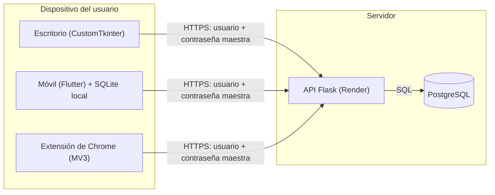

# Modelo de amenazas de Lockbox

Documenta el contenido del control **DIS-01 · P1** del checklist de seguridad: qué protegemos, contra quién, por dónde pueden atacar y qué **no** cubrimos.

- **Versión:** 1.1 · 1 de noviembre de 2026 (revisión DIS-01)
- **Estado del código analizado:** código funcional en `ebc0598` (2026-10-18), revisado contra `fe973f2` (2026-10-24, HEAD). Entre ambos commits solo hay cambios de documentación; no cambió el código de la aplicación.
- **Alcance del análisis:** lectura del código de `app_api.py`, `app_db.py`, `seguridad.py`, `app_gui.py`, `lockbox_mobile/` y `Lockbox_Extension/`. No es una auditoría completa ni una prueba de penetración.

---

## 1. Componentes en alcance

| Componente | Tecnología | Archivos | Dónde corre |
|---|---|---|---|
| API | Flask + gunicorn | `app_api.py`, `seguridad.py`, `app_db.py` | Render (`lockbox-appi.onrender.com`) |
| Base de datos | PostgreSQL (`DATABASE_URL`) | `app_db.py` | Servicio externo (el código menciona Supabase) |
| App de escritorio | Python + CustomTkinter | `app_gui.py` | PC del usuario |
| App móvil | Flutter | `lockbox_mobile/` | Android / iOS del usuario |
| Extensión de navegador | Chrome Manifest V3 | `Lockbox_Extension/` | Navegador del usuario |
| API heredada | FastAPI | `api.py` | Ningún cliente la usa; ver T-14 |

Los tres clientes hablan con la misma API por HTTPS. No hay acceso directo a la base de datos desde los clientes.

### 1.1 Rutas no activas o código muerto

- **`/api/vault` (móvil):** `lockbox_mobile/lib/repositories/vault_repository.dart:24-70` define `addVaultItem()` y hace `POST $baseUrl/vault`, pero no existe ninguna ruta `/api/vault` en `app_api.py` ni en `api.py`. No se encontraron llamadores de `addVaultItem()` en el código actual (solo la definición). Es código muerto o una sincronización incompleta, **no una ruta activa**; no debe contarse como superficie de ataque. Su eliminación o corrección es una tarea funcional independiente.

---

## 2. Qué protegemos (activos)

| Activo | Importancia | Dónde vive hoy |
|---|---|---|
| Contraseñas guardadas por el usuario | Crítica | BD cifradas con Fernet; en claro en memoria de la API al descifrar y en memoria/caché de los clientes |
| Hash determinístico de contraseñas (`password_hash`) | Media | BD, columna `credenciales.password_hash` (64 hex). HMAC-SHA256 con la clave derivada de la contraseña maestra; solo detecta reutilización. Sin la clave derivada no permite recuperar ni verificar contraseñas; con ella, el atacante ya puede descifrar la bóveda, por lo que el hash añade sobre todo la detección de contraseñas repetidas. `NULL` en filas antiguas hasta el backfill. |
| Contraseña maestra | Crítica | Solo su hash bcrypt en la BD; en claro en tránsito (HTTPS), en memoria de la API, del escritorio y de la extensión, y en el almacén seguro del móvil |
| Clave de recuperación (`LOCK-XXXX-XXXX`) | Alta | Hash bcrypt en la BD; el usuario la guarda en papel |
| Sitios, usuarios de login, categorías y fechas | Alta | En claro en la BD (no cifrados) |
| Tokens JWT (acceso 15 min, refresco 7 días) | Media | Memoria del cliente / Keystore o Keychain en móvil / `chrome.storage.session` en la extensión |
| Secretos del servidor (`JWT_SECRET_KEY`, `DATABASE_URL`) | Crítica | Variables de entorno en Render; `.env` local fuera de git |
| Integridad y disponibilidad de la bóveda | Alta | BD y copia local del móvil |

`password_hash` no es un hash de autenticación: no se compara con la contraseña maestra ni se usa para el login. Es un dato derivado, determinístico por usuario, que solo sirve para detectar reutilización de contraseñas (`seguridad.py:138-146`, `app_db.py:190-197`, `app_api.py:558-580,700-719`).

---

## 3. Modelo de confianza (lo más importante de este documento)

**Lockbox hoy no es de conocimiento cero ni cifrado de extremo a extremo.**

- Los clientes envían la **contraseña maestra en claro** (dentro de HTTPS) en cada petición a la API.
- La API verifica el hash bcrypt, **deriva la clave Fernet en el servidor** (PBKDF2-HMAC-SHA256, 600 000 iteraciones, sal de 16 bytes por usuario) y **cifra o descifra allí**. Las contraseñas descifradas viajan de vuelta al cliente.
- Los logs actuales de `app_api.py` no registran el cuerpo de las peticiones ni `master_password`: solo ruta, método, `sub` del JWT y mensajes de error (ver T-05 y §6).
- Varios comentarios del código hablan de «Zero-Knowledge»: `api.py:153,172`, `popup.js:4` y `api.py:184` (descifrado local en la API heredada). Eso describe una intención o una API heredada, no el flujo real de `app_api.py`. El módulo criptográfico de `popup.js` (`deriveKeys`, `encryptLocal`) existe pero no se usa.

Consecuencias:

- **Quien obtenga solo un volcado de la base de datos** ve datos cifrados y hashes lentos, pero no las contraseñas. Debe atacar la contraseña maestra por fuerza bruta (ver T-04).
- **Quien controle el proceso de la API, su memoria o el proxy/TLS termination mientras alguien inicia sesión** puede capturar la contraseña maestra y todo lo que descifre (ver T-05). Hoy no hay defensa contra esto. Los logs tal como están implementados no son el vector principal; el riesgo es el proceso/servidor o la infraestructura que termina TLS.
- **Quien solo tenga acceso a los logs actuales** no obtiene la contraseña maestra ni las contraseñas descifradas, salvo que el código de logging cambie o el proveedor registre cuerpos a nivel de infraestructura.

**En qué confiamos:** en el servidor y su proveedor (Render y el proveedor de la BD) para la confidencialidad de lo que pasa por la API, y en el sistema operativo y el hardware del dispositivo del usuario.

**Decisión pendiente** (relacionada con DIS-12, GP-01 y GP-05): o se migra a cifrado de extremo a extremo real, o se mantiene este modelo y se comunica con honestidad como «cifrado en reposo con clave derivada de tu contraseña», sin llamarlo conocimiento cero.

---

## 4. Adversarios

| ID | Quién | Qué puede hacer | ¿En alcance? |
|---|---|---|---|
| A1 | Atacante remoto anónimo | Probar contraseñas, enumerar usuarios, abusar de la API | Sí |
| A2 | Quien obtiene la base de datos (filtración, copia de seguridad, error del proveedor, inyección SQL) | Ataque offline contra hashes y datos cifrados | Sí |
| A3 | Atacante en la red (Wi-Fi hostil, proxy) | Interceptar o alterar tráfico | Sí |
| A4 | Sitio web malicioso o phishing | Engañar al autorrelleno de la extensión | Sí |
| A5 | Persona con el móvil o el PC un rato (robo, descuido) | Abrir la app, leer datos locales | Sí, con límites (sección 7) |
| A6 | Atacante a la cadena de suministro (dependencias, cuentas de GitHub, Render, Chrome Web Store) | Colar código malicioso | Sí |
| A7 | Servidor o proveedor comprometido o malicioso | Leer todo lo que pasa por la API | Aceptado hoy, no mitigado (T-05) |
| A8 | Malware con ejecución en el dispositivo del usuario | Leer memoria, teclado, pantalla | **No** (sección 7) |

---

## 5. Amenazas, defensas actuales y riesgo residual

Los IDs entre paréntesis son controles del checklist que cerrarían la brecha. Este documento **no** los marca como hechos.

| ID | Amenaza | Qué hay hoy | Riesgo residual |
|---|---|---|---|
| T-01 | **Fuerza bruta** contra el login y contra los endpoints que validan la contraseña maestra (A1) | Flask-Limiter, por IP: `/api/login` 5/min; `/api/register` y `/api/recover` 3/min; `/api/credentials` y `/api/credentials/search` 30/min; `/api/credentials/add`, `/api/credentials/update` y `/api/credentials/delete` 10/min; `/api/auth/refresh` 10/min; global 60/min. bcrypt con coste 12. Mensaje genérico en login | Contadores en memoria (`memory://`): se pierden al reiniciar y no se comparten entre workers de gunicorn. Solo por IP, no por cuenta. Sin MFA (AUT-01, AUT-02, AUT-03) |
| T-02 | **Enumeración de usuarios** (A1) | El login responde igual con usuario o contraseña incorrectos | `/api/register` dice «El usuario ya existe» y `/api/recover` dice «El usuario no existe» (PWD-08) |
| T-03 | **Autenticación débil por diseño** (A1) | Hay JWT con rotación y lista de revocación | Los endpoints de credenciales usan `token_opcional_log` (modo «soft launch»): aceptan peticiones sin JWT. Solo la contraseña maestra autentica; el JWT hoy no protege nada (ACC-01, SES-08) |
| T-04 | **Robo o filtración de la BD** (A2) | Contraseñas con Fernet (AES-128-CBC + HMAC-SHA256) y clave PBKDF2 600 000 iteraciones. Contraseña maestra y clave de recuperación con bcrypt. `password_hash` es HMAC-SHA256 determinístico con la clave derivada y solo se usa para detectar reutilización. | Sitio, usuario y categoría en claro. También se filtra `password_hash`: es un HMAC determinístico con la clave derivada; sin esa clave no permite recuperar ni verificar contraseñas. Si el atacante ya tiene la clave, puede descifrar la bóveda, así que el hash añade principalmente la detección de contraseñas repetidas del mismo usuario. No es un hash de autenticación. La contraseña maestra solo exige 8 caracteres y no se compara con una lista de filtradas, lo que facilita el ataque offline (PWD-04, PWD-05, GP-08) |
| T-05 | **Servidor, proceso de la API o infraestructura de red comprometidos** (A7) | HTTPS en tránsito; secretos del servidor por variables de entorno. Los logs de la aplicación no registran cuerpos ni `master_password` (solo ruta, método, `sub` y errores). | La contraseña maestra llega en claro al proceso en cada petición. Compromiso total para cualquier usuario que inicie sesión durante el incidente. Un proxy o la infraestructura que termina TLS (Render) podría inspeccionar el cuerpo si está comprometida o registra tráfico; los logs actuales de la app, por sí solos, no contienen la maestra ni las contraseñas descifradas (GP-01, GP-05, GP-70) |
| T-06 | **Filtración de `JWT_SECRET_KEY` o `DATABASE_URL`** (A6) | Obligatorios al arrancar; `.env` está en `.gitignore` y no versionado. `repomix-output.xml` se retiró del seguimiento de Git en la revisión DIS-01. La copia local se conserva y está excluida por `.gitignore`; las versiones anteriores permanecen en el historial. Inspección de secretos: No se detectaron credenciales reales durante la inspección realizada. La comprobación fue dirigida y no constituye un escaneo exhaustivo. | Sin rotación de secretos. HS256 simétrico (SEC-01, SEC-03, SEC-08). Los metadatos de conexión que aparecen en repomix son valores de fallback locales/genéricos y no identifican proveedor ni instancia; no son credenciales. Si el archivo se vuelve a añadir al índice, repetir la inspección. |
| T-07 | **Abuso de la recuperación de cuenta** (A1, A2) | `/api/recover` limitado a 3/min; la clave se muestra una sola vez; se guarda como hash bcrypt | La clave `LOCK-XXXX-XXXX` tiene solo **32 bits de entropía** y, con la BD en mano, se puede atacar offline. Al recuperar se cambian hash y sal, pero **no se recifran** las credenciales: quedan indescifrables (pérdida de acceso) (AUT-04, AUT-05, GP-13) |
| T-08 | **Red hostil** (A3) | HTTPS hacia Render en los tres clientes | Sin fijación de certificado. HSTS no se configura en el código de la API. La extensión permite `http://localhost` (RED-02, RED-06) |
| T-09 | **Móvil perdido o robado** (A5) | Tokens y contraseña maestra en Keystore/Keychain. Bloqueo con biometría o contraseña maestra (bcrypt local). Tras 5 fallos se cierra la sesión. Android con `allowBackup=false` según el último commit | La biometría es solo una compuerta de interfaz, no protege ninguna clave. La contraseña maestra en claro queda guardada en el almacén seguro. **`lockbox_offline.db` no está cifrada y guarda las contraseñas en claro** (la columna se llama `encrypted_password`, pero se rellena con el valor descifrado que devuelve la API). Copias de seguridad en iOS: no verificadas (MOV-01, MOV-04, MOV-05, GP-22, GP-23, GP-61) |
| T-10 | **Sitio malicioso contra la extensión** (A4) | Manifest V3. Permisos declarados: `storage` (tokens y `masterPassword` en `chrome.storage.session`), `clipboardWrite` (copia con `navigator.clipboard.writeText`), `activeTab` (acceso temporal a la pestaña activa) y `scripting` (`chrome.scripting.executeScript` para el autorrelleno). Hosts: `https://lockbox-appi.onrender.com/*`, `http://127.0.0.1/*`, `http://localhost/*`. Autorrelleno solo con clic; interfaz sin `innerHTML`. | El autorrelleno inyecta en el primer campo de contraseña de la pestaña **sin comprobar que el dominio coincide** con la credencial. Las contraseñas se muestran en claro en el popup por defecto. `clipboardWrite` no concede lectura: el código llama a `navigator.clipboard.readText()` para verificar antes de limpiar, pero no declara `clipboardRead` y el error se captura en silencio; la autolimpieza podría no verificar el contenido. Los hosts `http://localhost/*` y `http://127.0.0.1/*` son de desarrollo y amplían la superficie si la extensión se usa en producción. (GP-41, GP-42, GP-30) |
| T-11 | **PC de escritorio desatendido** (A5) | Contraseña visible 15 s, portapapeles limpiado a los 30 s, caché y sesión borradas al cerrar sesión | Contraseña maestra y caché descifrada en memoria durante la sesión. No se observó bloqueo por inactividad (GP-20, GP-21) |
| T-12 | **Cadena de suministro y cuentas de publicación** (A6) | Python: versiones exactas en `requirements.txt` (sin hashes). Flutter/Dart: `pubspec.yaml` usa rangos caret (`^`) y `pubspec.lock` está versionado en Git con versiones exactas y hashes `sha256` de los paquetes; `flutter pub get` respeta el lockfile. | Sin hashes en `requirements.txt`; sin CI ni escaneo de dependencias o secretos (no hay carpeta `.github`). En Dart, `^1.2.3` permite `>=1.2.3 <2.0.0`; en versiones `0.x`, el límite depende de la primera parte distinta de cero (por ejemplo, `^0.2.3` permite `<0.3.0`; `^0.0.3` permite `<0.0.4`). `flutter pub upgrade` puede actualizar dentro de ese rango; la reproducibilidad depende del lockfile versionado, no de una verificación de firmas. `pubspec.yaml` declara un mínimo de Dart `>=3.3.0`. El bloque `sdks` de `pubspec.lock` indica que la resolución actual de dependencias requiere Dart `>=3.5.0`. Por tanto, el mínimo efectivo para utilizar el conjunto de dependencias bloqueado es `3.5.0`; esto no constituye por sí solo un error de configuración. MFA en GitHub, Render, la BD y Chrome Web Store: sin verificar (DEP-03, DEP-07, TST-02, SEC-03) |
| T-13 | **Abuso y denegación de servicio** (A1) | Límite global de 60/min por IP | Sin límite de tamaño del cuerpo de la petición; `/api/categories` es público (API-02) |
| T-14 | **API heredada `api.py`** (A1) | Ningún cliente la usa | Define `/api/buscar` (POST: `sitio`, `username`, `master_password`; valida la maestra, deriva Fernet y devuelve contraseñas descifradas), `/api/credentials/list` (devuelve registros cifrados solo con `username`), `/api/credentials/add` (acepta datos pre-cifrados sin autenticación), `/test-db` y `/` sin autenticación. No tiene JWT ni rate limiting: el `default_limits=["60 per minute"]` pertenece a Flask-Limiter en `app_api.py`; `api.py` es FastAPI y solo registra `CORSMiddleware`, sin `Limiter`, `SlowAPIMiddleware` ni decoradores de límite, por lo que ningún endpoint heredado queda limitado. Si se despliega, queda expuesta; `/api/buscar` además permite enumerar usuarios (404 vs 401) y probar contraseñas maestras sin límite. Confirmar que no se despliega y eliminarla (DIS-08, API-01) |
| T-15 | **Errores que filtran detalles** (A1) | Mensajes genéricos en login | `update_credential` y `delete_credential` devuelven `str(e)` al cliente (LOG-03, API-10) |

---

## 6. Por dónde puede entrar un atacante (superficie de ataque)

1. **Endpoints de la API Flask (`app_api.py`)**:
   - Públicos: `/api/ping`, `/api/categories`, `/api/register`, `/api/login`, `/api/recover`.
   - Credenciales: `/api/credentials`, `/api/credentials/search`, `/api/credentials/add`, `/api/credentials/update`, `/api/credentials/delete`; usan `token_opcional_log` (JWT opcional) y se autentican con la contraseña maestra. `/api/credentials/search` (30/min) recibe `query`, `username` y `master_password`, y devuelve contraseñas descifradas; es una superficie sensible equivalente a `/api/credentials`.
   - Sesión: `/api/auth/refresh` (POST, recibe `refresh_token`, rota el par y revoca el JTI usado; 10/min) y `/api/auth/logout` (JWT requerido, revoca JTI).
2. **API heredada `api.py` (FastAPI)**: `/`, `/test-db`, `/api/buscar`, `/api/credentials/add` y `/api/credentials/list`; sin JWT ni rate limiting. `/api/buscar` recibe usuario y contraseña maestra y devuelve contraseñas descifradas. Si no se despliega, no es superficie activa; si se despliega, es crítica.
3. **CORS de la API Flask**: lista blanca `ALLOWED_ORIGINS` (por defecto `http://127.0.0.1:5000`, `http://localhost:5000`, `http://127.0.0.1:8000` y `http://localhost:8000`; se amplía con la variable `ALLOWED_ORIGINS` y, opcionalmente, `EXTENSION_ID`), `supports_credentials=True`, métodos y cabeceras explícitos. CORS solo lo aplican los navegadores: **no autentica ni protege contra clientes que no son navegadores** (curl, scripts, apps móviles). Una lista mal configurada puede permitir que un origen web no confiable lea respuestas; no sustituye a JWT, rate limiting ni validación de la contraseña maestra.
4. **La base de datos** y sus copias de seguridad en el proveedor.
5. **Variables de entorno y logs en Render**: `.env` local no versionado; secretos en variables de entorno. Los logs actuales de la app no registran cuerpos ni `master_password`; el riesgo es el acceso a la infraestructura/proxy que termina TLS, no los logs tal como están.
6. **Almacenamiento local del móvil** (Keystore/Keychain y SQLite sin cifrar).
7. **Páginas web que visita el usuario** con la extensión activa (autorrelleno; permisos `activeTab` y `scripting`).
8. **Portapapeles** de los tres clientes (`clipboardWrite` en la extensión; limpieza a los 30 s).
9. **Dependencias y cuentas de publicación** (pip, pub, GitHub, Render, Chrome Web Store).
10. **Rutas no activas:** `/api/vault` solo aparece en código móvil muerto; no existe en la API. No es superficie de ataque actual.

---

## 7. Qué NO cubrimos

**Fuera de alcance por decisión:**

- Malware, keyloggers o extensiones maliciosas con ejecución en el dispositivo del usuario (A8).
- Móviles con root o jailbreak, y análisis forense con el dispositivo desbloqueado.
- Coerción física y robo de la contraseña maestra por ingeniería social.
- Ataques de canal lateral y de hardware.
- Denegación de servicio volumétrica (DDoS).
- Seguridad de la infraestructura interna de Render y del proveedor de la BD más allá de lo descrito en T-04 y T-05.
- Resistencia a la computación cuántica.

**Aceptado hoy, sin mitigar** (se revisará según la decisión de la sección 3):

- Servidor o proceso de la API comprometidos mientras alguien inicia sesión (T-05).
- Metadatos (sitio, usuario, categoría, fechas) visibles para quien tenga la BD (T-04).

**No evaluado todavía:** cumplimiento legal (RGPD, Reglamento de Ciberresiliencia de la UE), accesibilidad y disponibilidad garantizada.

---

## 8. Supuestos

- Los certificados TLS de Render son válidos y el tráfico no se degrada a HTTP.
- Keystore/Keychain y el aislamiento de aplicaciones del sistema operativo funcionan como se espera.
- La base de datos no es accesible desde Internet salvo para la API (pendiente de verificar).
- El usuario elige una contraseña maestra larga y única y guarda su clave de recuperación fuera de línea.
- La lista `ALLOWED_ORIGINS` en producción contiene solo orígenes confiables y no incluye `*` ni hosts de desarrollo (pendiente de verificar).

---

## 9. Prioridades derivadas

Orden orientativo para trabajar el checklist, de mayor a menor riesgo. No es un compromiso de implementación.

1. Decidir el modelo de confianza: cifrado de extremo a extremo real o documentar el modelo actual (T-05, T-03).
2. Cifrar o dejar de guardar contraseñas en claro en `lockbox_offline.db` (T-09).
3. Rediseñar la recuperación de cuenta: más entropía y recifrado de la bóveda (T-07).
4. Comprobar el dominio antes de autorrellenar en la extensión (T-10).
5. Confirmar y eliminar `api.py`; mantener `repomix-output.xml` fuera del índice y repetir la inspección si se vuelve a añadir (T-14, T-06).

---

## 10. Mantenimiento de este documento

Revísalo cuando cambie la arquitectura, se añada un cliente, un endpoint, un permiso o un dato sensible, y antes de cada versión publicada. Revisión anual mínima (OPS-11). La regla de actualización en el mismo cambio está en la sección 11.

| Fecha | Cambio |
|---|---|
| 2026-10-21 | Versión 1.0: primera redacción a partir del código en `ebc0598` |
| 2026-11-01 | Versión 1.1 (revisión DIS-01): `password_hash`, `/api/buscar`, CORS, `/api/auth/refresh`, dependencias Dart, permisos de la extensión, precisión sobre logs, `/api/vault`, trazabilidad y limitación histórica |

---

## 11. Limitación histórica y regla para cambios futuros

Este modelo se redactó **después** de que existiera el código: se añadió en el commit `35d6699` (2026-10-22) y analizó el commit `ebc0598` (2026-10-18); el desarrollo ya estaba en marcha desde septiembre de 2026. Por tanto, **no puede demostrarse que precediera a la programación original**. Esta limitación es histórica y no invalida el contenido actual, pero impide afirmar que DIS-01 se cumplió en el orden temporal previsto.

**Regla a partir de ahora:** todo cambio de arquitectura, endpoint, permiso, dependencia relevante o dato sensible debe actualizar este documento en el mismo cambio (mismo commit/PR). Si el cambio no se refleja aquí, se considera incompleto.
